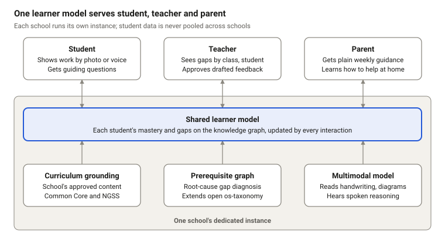
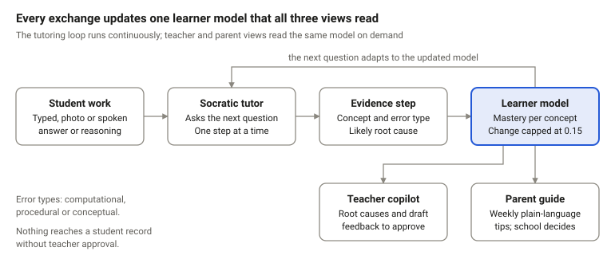
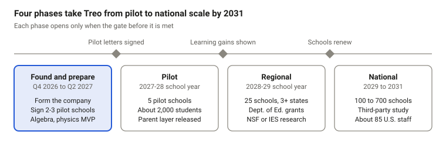

# Treo: one learner model for the student, the teacher, and the parent

Treo is a proposed responsible AI learning platform for grades 8–12 STEM. It is designed around a simple idea: the student, teacher, and parent should work from the same evolving picture of what a learner understands, where they are stuck, and what support would help next.

This repository contains version 1.0 of the Treo whitepaper, published October 27, 2026, by Kofi Obo Wood.

[Visit the website](https://treo-ai-whitepaper.vercel.app) · [Read the whitepaper](WHITEPAPER.md) · [Download the PDF](treo-whitepaper.pdf)

> **Project status:** Treo is at the prototype stage. The whitepaper distinguishes current prototype capabilities from planned pilot and production work. Pricing, adoption, and growth figures are planning assumptions—not forecasts or deployed results.



## The problem

A student's difficulty with an algebra or physics problem often begins with a small prerequisite gap. The student sees the immediate problem, the teacher sees delayed results from many students, and the parent may see only a grade. None has a complete, timely picture.

General-purpose AI chatbots do not solve this by default. They can improve practice performance by supplying answers while weakening durable learning. Treo instead focuses on diagnosis, guided reasoning, and useful information for the adults supporting the student.

## The Treo approach

Treo maintains one standards-aligned learner model for each student. Every learning exchange produces structured evidence that can update the student's estimated mastery of individual concepts and identify likely prerequisite gaps.

That shared model powers three experiences:

| User | Treo experience |
|---|---|
| **Student** | A Socratic tutor that asks guiding questions, works one step at a time, and accepts typed or photographed work; voice is planned. |
| **Teacher** | A copilot that surfaces misconceptions and likely root causes, recommends a short teaching move, and drafts feedback for the teacher to approve, edit, or reject. |
| **Parent** | A school-controlled, plain-language guide explaining what the student worked on, where they struggled, and how to help at home in the family's language. |

The learner model sits on a prerequisite graph aligned to Common Core mathematics and NGSS science standards. If a student struggles with slope-intercept form, for example, Treo can test whether the deeper issue is slope, solving two-step equations, or operations with negative numbers.

## Design principles

1. **Socratic by default.** The tutor guides the student's reasoning instead of completing an in-progress problem for them.
2. **One learner model, three views.** Students, teachers, and parents receive consistent guidance from the same evidence base.
3. **Root cause over right answer.** Treo classifies errors and traces them to likely prerequisite gaps.
4. **The teacher decides.** Teachers can inspect, edit, reject, and override AI-generated recommendations.
5. **Families are partners.** Parent guidance is concise, practical, translated, and governed by the school.
6. **Privacy is architectural.** The proposed production design isolates each school's data and does not pool student data across customers.

## How the evidence loop works

Each exchange passes through a structured assessment step:

1. The student submits an answer or explanation.
2. The Socratic tutor asks the next useful question.
3. A separate evidence step identifies relevant concepts, the error type, a likely root cause, and a teacher-verifiable explanation.
4. The server updates the learner model, limiting any mastery change to 0.15 per exchange.
5. The next tutoring move adapts to the updated model, while the teacher and parent views read from the same state.



## Prototype today

The working prototype uses fictional students and stores no data. It currently demonstrates:

- a Socratic tutor for a 10-concept graph spanning middle and early high school algebra and Newton's second law;
- typed answers and photographs of handwritten work;
- per-exchange learner-model updates with capped changes and computational, procedural, or conceptual error labels;
- likely root-cause highlighting;
- teacher summaries, suggested teaching moves, and draft feedback with approval controls; and
- a teacher-controlled parent view in the family's home language, demonstrated in Spanish.

The prototype does **not** yet include dedicated per-school deployment, a complete grades 8–12 knowledge graph, voice input, generated instructional visuals, or a class-level dashboard.

## Safety, privacy, and human oversight

The proposed safeguards include:

- automated adversarial tests that fail a release if the tutor gives away final answers;
- grounding in school-approved curriculum;
- release evaluations for accuracy, bias, hallucination, and age appropriateness;
- evidence-backed mastery updates with capped movement per exchange;
- teacher approval before AI-generated feedback enters a student record;
- a dedicated instance and data store for each school, with no advertising or cross-school data pooling; and
- school-controlled parent access that shares guidance rather than raw transcripts or scores.

These are design commitments at different stages of implementation. The [safeguards table in the whitepaper](WHITEPAPER.md#5-safeguards) labels what exists in the prototype and what must be completed before a pilot.

## Evaluation plan

The first proposed full pilot is planned for the 2027–28 school year. The evaluation is designed to test four questions:

- Do students using the Socratic tutor gain more on concept assessments and delayed-retention tests?
- Does Treo's root-cause diagnosis agree with expert teachers?
- Does the teacher copilot save time without reducing feedback quality?
- Does the parent guide increase useful family engagement?

The paper also defines failure conditions, including no learning gain, weaker delayed retention, diagnosis well below teacher-to-teacher agreement, or teachers rejecting most drafted feedback. Treo commits to publishing the evaluation protocol and results before scaling beyond pilot schools.

## Roadmap

The roadmap is gated by evidence rather than dates alone:

| Phase | Target | Gate or focus |
|---|---|---|
| **Found and prepare** | Q4 2026–Q2 2027 | Form the company, sign 2–3 pilot schools, and complete the algebra and physics MVP. |
| **Pilot** | 2027–28 school year | Run in five schools with about 2,000 students and release the parent layer. |
| **Regional** | 2028–29 school year | Expand only after showing learning gains; target 25 schools across at least three states. |
| **National** | 2029–2031 | Expand after school renewals, supported by third-party study and operational evidence. |



## What the whitepaper covers

The full paper includes:

- the problem and research base for AI-supported learning;
- product and instructional design principles;
- the learner model, prerequisite graph, evidence loop, and tutoring architecture;
- multimodal input and the longer-term research direction;
- teacher and parent experiences;
- safeguards, privacy, and human oversight;
- a public evaluation plan and explicit failure criteria;
- current prototype scope;
- a school and district business model; and
- an evidence-gated roadmap and open research questions.

## Repository contents

| Path | Description |
|---|---|
| [`WHITEPAPER.md`](WHITEPAPER.md) | Canonical, web-readable whitepaper source. |
| [`treo-whitepaper.pdf`](treo-whitepaper.pdf) | Print-ready version for downloading and sharing. |
| [`figures/fig1-architecture.svg`](figures/fig1-architecture.svg) | Shared learner-model architecture. |
| [`figures/fig2-evidence-loop.svg`](figures/fig2-evidence-loop.svg) | Per-exchange evidence and adaptation loop. |
| [`figures/fig3-roadmap.svg`](figures/fig3-roadmap.svg) | Evidence-gated product roadmap. |

## Rebuilding the PDF

The Markdown file is the canonical source. To produce a self-contained HTML file with Pandoc:

```bash
pandoc WHITEPAPER.md \
  --standalone \
  --embed-resources \
  --resource-path=. \
  --output=whitepaper.html
```

Open `whitepaper.html` in a browser and print it to PDF using Letter paper with background graphics enabled. Save the result as `treo-whitepaper.pdf`.

## Review and collaboration

Treo is seeking feedback from:

- grades 8–12 mathematics and physical-science educators;
- school and district leaders considering a 2027–28 pilot;
- learning scientists reviewing the prerequisite graph and evaluation design; and
- researchers working on multimodal reasoning from handwritten, visual, or spoken student work.

Questions and review notes can be submitted through this repository's GitHub issues. The open research questions are listed in [Section 10 of the whitepaper](WHITEPAPER.md#10-open-questions-and-an-invitation).

## Author and version

**Kofi Obo Wood** is a technical product manager and AI engineer focused on AI learning systems. See the [author biography](WHITEPAPER.md#about-the-author) for additional background.

- Whitepaper version: **1.0**
- Publication date: **October 27, 2026**
- Scope: **Responsible AI learning platform for grades 8–12 STEM**

This work is available under the [Creative Commons Attribution 4.0 International License](docs/whitepaper/LICENSE). Reuse and adaptation are permitted with appropriate attribution.
